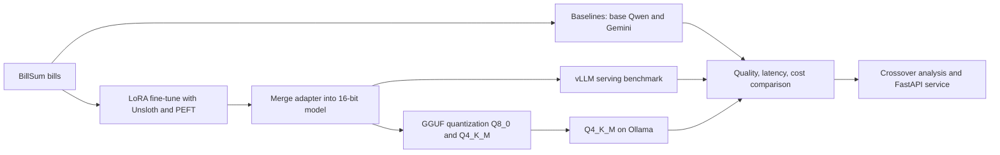
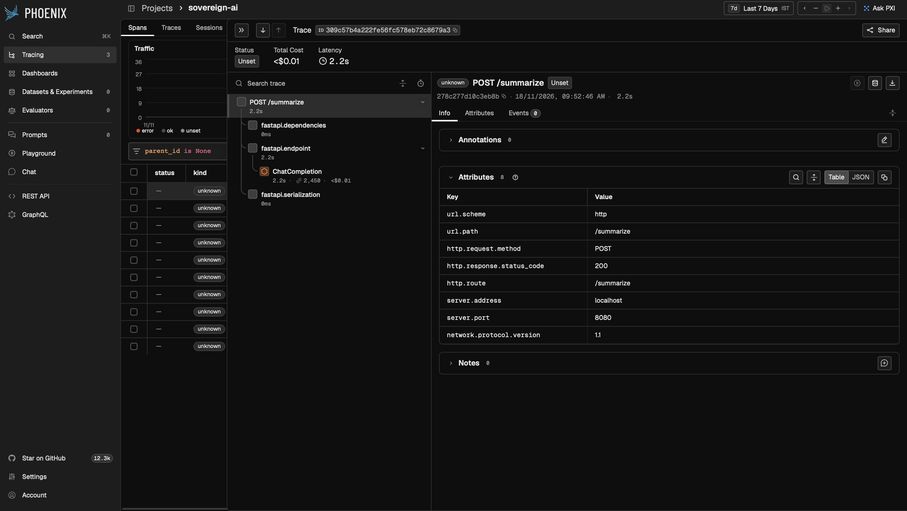

# Sovereign AI Engine: summarizing US legislation with a model you run yourself

> **One-line answer:** a small open-weight model (3B parameters), fine-tuned for free on a single T4 GPU, scored higher than a low-cost API model (Gemini 3.1 Flash-Lite) on ROUGE-2, ROUGE-L and BERTScore, whether the API model was prompted with zero or two examples (ROUGE-1 is level with the 2-shot prompt), and above roughly **472,705 calls per month** it is also cheaper to run yourself.
>
> **Licensing note:** the base model (Qwen2.5-3B-Instruct) is released under the Qwen Research License, which allows non-commercial use only. See section 13.

## 1. Purpose of this project

Many organizations (hospitals, banks, courts, governments) want AI to read long documents but cannot send them to an outside company, or find the per-call API bill too high at scale. This project tests the alternative, a **"sovereign" AI engine**: an open-weight model that runs on hardware you control.

| Question | How this project answers it |
|---|---|
| Is a small open model good enough? | Baselined a 3B open model against a low-cost API model on 200 unseen bills. |
| Is fine-tuning worth it? | Measured quality before and after LoRA fine-tuning on 1,500 bills. |
| What does making the model smaller cost? | Compared 16-bit against 4-bit (Q4_K_M) for size and quality. |
| Can it serve real traffic? | Benchmarked P50 and P95 latency and throughput on vLLM at 1, 8 and 32 concurrent requests. |
| When does self-hosting become cheaper? | Computed cost per 1,000 calls and the monthly crossover volume. |
| Is it deployable? | Wrapped it in a FastAPI service with Docker and Phoenix tracing. |

**Who this is for:** engineers and managers deciding between "pay an API" and "run our own model", and anyone who wants a worked, measured example of that decision.

## 2. The task and the data

- **Task:** read a US congressional bill and write a short, factual legislative summary (at most 200 words).
- **Dataset:** [BillSum](https://arxiv.org/abs/1910.00523) (Kornilova and Eidelman, 2019), loaded as `FiscalNote/billsum`: US congressional bills paired with expert-written summaries.
- **Training data:** 1,500 bills from the train split (bills under 12,000 characters and 3,072 tokens).
- **Evaluation data:** the first 200 bills of the official test split (under 12,000 characters). None were used for training.

## 3. Systems compared

| System | Where it runs | Role |
|---|---|---|
| Base Qwen2.5-3B-Instruct | Ollama, MacBook M4 | Small open model, no training |
| Gemini 3.1 Flash-Lite, zero-shot | Google API | Low-cost API baseline |
| Gemini 3.1 Flash-Lite, 2-shot | Google API | Same model with two example bill and summary pairs in the prompt (the two shortest training bills, so the prompt grows by about 2,800 tokens) |
| Fine-tuned Qwen2.5-3B, 16-bit | vLLM, Kaggle T4 GPU | The sovereign model at full precision |
| Fine-tuned Qwen2.5-3B, Q4_K_M | Ollama, MacBook M4 | The same model shrunk to 4-bit |



## 4. Results

### 4.1 Summary quality (200 test bills)

| System | Runs on | ROUGE-1 | ROUGE-2 | ROUGE-L | BERTScore F1* |
|---|---|---|---|---|---|
| Base Qwen2.5-3B-Instruct | Ollama on MacBook M4 | 0.492 | 0.237 | 0.319 | 0.813 |
| Gemini 3.1 Flash-Lite, zero-shot | Google API | 0.502 | 0.228 | 0.320 | 0.820 |
| Gemini 3.1 Flash-Lite, 2-shot | Google API (2 example pairs in the prompt) | 0.539 | 0.285 | 0.375 | 0.841 |
| Fine-tuned Qwen2.5-3B, 16-bit | vLLM on Kaggle T4 (concurrency 8) | 0.536 | 0.342 | 0.409 | 0.852 |
| Fine-tuned Qwen2.5-3B, Q8_0 | Ollama on MacBook M4 | 0.559 | 0.356 | 0.423 | 0.854 |
| Fine-tuned Qwen2.5-3B, Q4_K_M | Ollama on MacBook M4 | 0.529 | 0.328 | 0.400 | 0.846 |

\*BERTScore used `distilbert-base-uncased`, so compare these numbers only with each other, not with published BERTScores.

**What this shows**
- Fine-tuning raised ROUGE-2 from 0.237 to 0.342 (about 44% relative) and ROUGE-L from 0.319 to 0.409.
- The fine-tuned model beat the zero-shot Gemini 3.1 Flash-Lite baseline on every ROUGE metric and on BERTScore.
- Giving Gemini two example bill and summary pairs in the prompt (2-shot) moved its ROUGE-L from 0.320 to 0.375, against 0.409 for the fine-tuned 16-bit model. The fine-tuned model is still ahead on ROUGE-L; section 4.7 gives the confidence interval.
- Two examples closed about 62% of the ROUGE-L gap between zero-shot Gemini and the fine-tuned model, and 2-shot Gemini (0.539) is level with the fine-tuned model (0.536) on ROUGE-1. The fine-tuned model's clear leads are on ROUGE-2, ROUGE-L and BERTScore. Few-shot prompting is the cheaper first step, but the longer prompt raises API cost (section 4.8).
- The gain comes largely from learning the legislative summary style and length, which the BillSum references share. A general-purpose API model is not trained for that style.

### 4.2 LLM-judge check
An LLM-judge pass is not included. A first attempt with a lenient rubric and Gemini Flash-Lite as judge was discarded: it gave Gemini a perfect 5.0 on its own summaries and ranked the base model above the fine-tuned one, which contradicts every other metric.

### 4.3 What 4-bit quantization cost

| Format | File size | ROUGE-1 | ROUGE-L | Notes |
|---|---|---|---|---|
| fp16 | 5.8 GB | 0.536 | 0.409 | Reference quality |
| Q8_0 | 3.1 GB | 0.559 | 0.423 | No significant loss versus fp16 (see 4.7) |
| Q4_K_M | 1.8 GB | 0.529 | 0.400 | Keeps 98.7% of fp16 ROUGE-1 at 31% of the size |

Quantizing to 4-bit lost 0.007 ROUGE-1 and 0.009 ROUGE-L, and the 4-bit model still beat the base model and zero-shot Gemini on every metric (it trails 2-shot Gemini on ROUGE-1). A paired bootstrap (section 4.7) shows this gap is within noise, so the quality cost of Q4_K_M is not statistically distinguishable from zero on 200 bills. Q8_0 scored 0.559 ROUGE-1 and 0.423 ROUGE-L with no significant loss against fp16. Its small ROUGE-1 edge over the vLLM fp16 run is not a benefit of quantization: it likely reflects generation differences (Q8_0 outputs were shorter, 154 versus 171 words, and hit the 300-token cap less often). Q4_K_M scored significantly below Q8_0 (about 0.03 ROUGE-1 and 0.02 ROUGE-L), so going from 8-bit to 4-bit has a small but measurable cost. For a laptop or edge deployment that trade is usually worth it.

### 4.4 Serving benchmark (fine-tuned 16-bit, vLLM, Kaggle T4)

| Concurrent requests | P50 latency (s) | P95 latency (s) | Output tokens/s | Requests/s |
|---|---|---|---|---|
| 1 | 7.78 | 12.51 | 24.6 | 0.13 |
| 8 | 15.69 | 26.54 | 104.1 | 0.49 |
| 32 | 53.06 | 86.47 | 125.5 | 0.59 |

- Throughput rises with concurrency (24.6 to 125.5 tokens/s) but latency rises faster, so for interactive use keep concurrency low and add GPUs for volume.
- The server ran with `--enforce-eager` to fit the free T4. Throughput with CUDA graphs enabled would likely be higher.
- Quality did not change with load: ROUGE-1 stayed between 0.536 and 0.538 at all concurrency levels.

### 4.5 Observed latency per system (not directly comparable)

| System | Runs on | P50 (s) | P95 (s) |
|---|---|---|---|
| Base Qwen2.5-3B-Instruct | Ollama on MacBook M4 | 15.2 | 25.2 |
| Gemini 3.1 Flash-Lite, zero-shot | Google API | 3.2 | 7.5 |
| Gemini 3.1 Flash-Lite, 2-shot | Google API (2 example pairs in the prompt) | 1.8 | 3.9 |
| Fine-tuned Qwen2.5-3B, 16-bit | vLLM on Kaggle T4 (concurrency 8) | 15.7 | 26.5 |
| Fine-tuned Qwen2.5-3B, Q8_0 | Ollama on MacBook M4 | 17.0 | 26.0 |
| Fine-tuned Qwen2.5-3B, Q4_K_M | Ollama on MacBook M4 | 15.0 | 36.6 |

These come from different hardware and software stacks (a Mac with Ollama, a T4 with vLLM, a network API), so do not rank the systems by this table. Use section 4.4 for serving claims.

### 4.5b Same-hardware speed: Q4_K_M versus Q8_0 (idle MacBook M4, Ollama)

| Model | Requests | P50 (s) | P95 (s) | Output tokens/s |
|---|---|---|---|---|
| Q8_0 | 58 | 14.15 | 23.2 | 12.3 |
| Q4_K_M | 58 | 10.38 | 18.34 | 15.8 |

Both models ran alternately on an otherwise idle machine, 29 bills per round, 2 rounds, 300-token cap.

### 4.6 Cost and the crossover point

| Item | Value |
|---|---|
| Gemini 3.1 Flash-Lite price (standard) | $0.25 per 1M input tokens, $1.50 per 1M output tokens |
| Average tokens per call (measured) | 1802 input, 214 output |
| **API cost per 1,000 calls** | **$0.772** |
| Self-hosted T4 cost per 1,000 calls at full load | $0.283 (concurrency 8) to $0.235 (concurrency 32) |
| GPU fixed cost (assumed $0.5/hr, 24/7) | $365 per month |
| Capacity of one T4 at concurrency 32 | about 1,550,520 calls per month |
| **Crossover volume** | **about 472,705 calls/month (about 15,757/day)** |


Below the crossover the API is cheaper because you pay nothing when idle. Above it, a busy GPU wins. The GPU price is an assumption: change it with `python src/cost.py YOUR_PRICE`.

### 4.7 Statistical checks

**Bootstrap 95% confidence intervals** (200 bills, 3,000 resamples):

| System | ROUGE-1 | ROUGE-2 | ROUGE-L |
|---|---|---|---|
| Base Qwen2.5-3B | 0.492 [0.478, 0.505] | 0.237 [0.228, 0.248] | 0.319 [0.309, 0.329] |
| Gemini 3.1 Flash-Lite (zero-shot) | 0.502 [0.489, 0.515] | 0.228 [0.219, 0.237] | 0.320 [0.310, 0.329] |
| Gemini 3.1 Flash-Lite (2-shot) | 0.539 [0.525, 0.552] | 0.285 [0.273, 0.297] | 0.375 [0.363, 0.388] |
| Fine-tuned 16-bit | 0.536 [0.516, 0.558] | 0.342 [0.322, 0.362] | 0.409 [0.389, 0.429] |
| Fine-tuned Q8_0 | 0.559 [0.539, 0.579] | 0.356 [0.336, 0.377] | 0.423 [0.403, 0.443] |
| Fine-tuned Q4_K_M | 0.529 [0.509, 0.549] | 0.328 [0.308, 0.348] | 0.400 [0.381, 0.420] |

**Paired differences in ROUGE-L** (same bills, bootstrap):

| Comparison | Mean difference | 95% CI | Verdict |
|---|---|---|---|
| Fine-tuned 16-bit minus Gemini 3.1 Flash-Lite (zero-shot) | +0.089 | [+0.071, +0.108] | significant |
| Fine-tuned 16-bit minus Gemini 3.1 Flash-Lite (2-shot) | +0.034 | [+0.016, +0.052] | significant |
| Fine-tuned 16-bit minus Base Qwen2.5-3B | +0.090 | [+0.071, +0.109] | significant |
| Fine-tuned 16-bit minus Fine-tuned Q4_K_M | +0.009 | [-0.009, +0.027] | not significant |
| Fine-tuned Q8_0 minus Fine-tuned 16-bit | +0.014 | [-0.001, +0.029] | not significant |
| Fine-tuned Q8_0 minus Fine-tuned Q4_K_M | +0.023 | [+0.008, +0.037] | significant |

A confidence interval that includes zero means the difference is not distinguishable from noise on 200 bills. Read each row accordingly.

**Length control.** Output caps differed: the 16-bit and Q4 runs were capped at 300 tokens, while base Qwen and Gemini had no cap. The share of outputs that hit 299 or more tokens, plus a rescoring with every output cut to its first 200 words (the length the prompt asked for):

| System | Hit 300-token cap | Avg words (reference 151) | ROUGE-L, full output | ROUGE-L, first 200 words |
|---|---|---|---|---|
| Base Qwen2.5-3B | 9.5% | 152 | 0.319 | 0.318 |
| Gemini 3.1 Flash-Lite (zero-shot) | 0.0% | 167 | 0.320 | 0.320 |
| Gemini 3.1 Flash-Lite (2-shot) | 0.0% | 152 | 0.375 | 0.375 |
| Fine-tuned 16-bit | 29.5% | 171 | 0.409 | 0.411 |
| Fine-tuned Q8_0 | 24.5% | 154 | 0.423 | 0.423 |
| Fine-tuned Q4_K_M | 20.0% | 144 | 0.400 | 0.400 |

After the 200-word cut, fine-tuned minus zero-shot Gemini is +0.092 ROUGE-L [+0.074, +0.110], significant.

**Numbers not found in the bill.** A crude grounding check: every number in a summary (2 or more characters) is searched for in the source bill. Misses include legitimate rewrites such as totals or spelled-out numbers, so only compare systems with each other.

| System | Numbers checked | Not in bill | Rate (95% Wilson CI) |
|---|---|---|---|
| Base Qwen2.5-3B | 738 | 24 | 3.3% [2.2%, 4.8%] |
| Gemini 3.1 Flash-Lite (zero-shot) | 718 | 22 | 3.1% [2.0%, 4.6%] |
| Gemini 3.1 Flash-Lite (2-shot) | 647 | 11 | 1.7% [1.0%, 3.0%] |
| Fine-tuned 16-bit | 523 | 28 | 5.4% [3.7%, 7.6%] |
| Fine-tuned Q8_0 | 541 | 16 | 3.0% [1.8%, 4.7%] |
| Fine-tuned Q4_K_M | 486 | 16 | 3.3% [2.0%, 5.3%] |

Fine-tuning improved style and overlap but showed no evidence of better factual grounding on this check: the 16-bit model had the highest rate of unmatched numbers, though its interval overlaps the others, so this is suggestive rather than conclusive. Verify facts before using any summary in a legal setting.

### 4.8 Cost sensitivity

The GPU price and how busy the GPU is both change the answer. Self-hosted cost per 1,000 calls (using the measured 0.59 requests/s at concurrency 32), against an API cost of $0.772 per 1,000 calls:

| GPU $/hr | 100% busy | 50% busy | 25% busy | 10% busy | Crossover (calls/month) |
|---|---|---|---|---|---|
| $0.25 | $0.12 | $0.24 | $0.47 | $1.18 | 236,352 |
| $0.35 | $0.16 | $0.33 | $0.66 | $1.65 | 330,893 |
| $0.50 | $0.24 | $0.47 | $0.94 | $2.35 | 472,705 |
| $0.75 | $0.35 | $0.71 | $1.41 | $3.53 | 709,057 |
| $1.00 | $0.47 | $0.94 | $1.88 | $4.71 | 945,409 |

- A GPU that is only 10% busy costs more per call than the API at every price above. Self-hosting needs steady volume.
- With the API's 50% batch discount ($0.386 per 1,000 calls) the crossover at $0.50/hr doubles to about 945,409 calls/month.
- Prices are assumptions, not quotes. Check current GPU and API rates before deciding.
- With the 2-shot prompt the measured API cost is $1.440 per 1,000 calls and the crossover at $0.50/hr is about 253,478 calls/month.

### 4.9 Where does it win or lose?

ROUGE-L by source bill length (quartiles of bill characters, about 50 bills each):

| System | Shortest 25% (5,008 to 6,171 chars) | 25-50% (6,194 to 7,788 chars) | 50-75% (7,799 to 9,903 chars) | Longest 25% (9,923 to 11,978 chars) |
|---|---|---|---|---|
| Base Qwen2.5-3B | 0.327 | 0.335 | 0.317 | 0.296 |
| Gemini zero-shot | 0.325 | 0.329 | 0.331 | 0.294 |
| Gemini 2-shot | 0.386 | 0.399 | 0.374 | 0.342 |
| Fine-tuned 16-bit | 0.426 | 0.428 | 0.412 | 0.370 |
| Fine-tuned Q4_K_M | 0.425 | 0.415 | 0.388 | 0.372 |

With about 50 bills per bin, differences between bins are indicative only and were not tested.

Per-bill comparison, fine-tuned 16-bit against 2-shot Gemini: the fine-tuned model scores higher on 54% of bills, lower on 46%. Averages hide variation, so see [docs/examples.md](docs/examples.md) for the three bills where the fine-tuned model gains most and the three where it loses most.

## 5. Which option should you pick?

| Your situation | Suggested option |
|---|---|
| Low or unpredictable volume, data may leave your network | Hosted API |
| Documents cannot leave your infrastructure (regulated or private data) | Self-host, even below the crossover |
| Steady volume above about 15,757 calls per day | Self-host the fine-tuned 16-bit model on a GPU |
| Laptop, edge or small server | Fine-tuned Q4_K_M, a small quality loss for a 3x smaller file |
| Need top quality on a narrow, well-defined task | Fine-tune a small model on your own examples |

## 6. What was built (repository map)

| Path | What it does |
|---|---|
| `scripts/prepare_data.py` | Builds the train and test subsets from BillSum |
| `scripts/train_unsloth.py` | LoRA fine-tuning with Unsloth and PEFT (run on a GPU) |
| `scripts/merge_lora_cpu.py` | Merges the adapter into the base model on CPU |
| `scripts/quantize_gguf.sh` | Builds Q8_0 and Q4_K_M GGUF files with llama.cpp |
| `scripts/bench_vllm.py` | Concurrency benchmark against a vLLM server |
| `src/run_ollama.py`, `src/run_gemini.py` | Generate summaries from the local model and the API |
| `src/score.py`, `src/bertscore_eval.py` | ROUGE and BERTScore evaluation |
| `src/judge_strict.py` | Strict-rubric LLM judge for faithfulness and coverage |
| `src/cost.py` | Cost per 1,000 calls and the crossover chart |
| `api/` | FastAPI service, Dockerfile, Phoenix tracing, switchable backends |
| `results/` | Raw model outputs, benchmark summary, crossover chart |

## 7. The serving API

`api/app.py` exposes `POST /summarize` and `GET /health`. A request picks a backend (`ollama`, `vllm` or `gemini`) through the same OpenAI-compatible interface, so the sovereign model and the API baseline can be swapped with one field. Every call is traced in Arize Phoenix (latency, tokens, input and output). Run `phoenix serve`, then open http://localhost:6006.

## 8. Technology and why each piece was used

| Tool | Purpose here |
|---|---|
| Unsloth | Fast, low-memory fine-tuning on a free T4 |
| Hugging Face PEFT / LoRA | Trains a small adapter (about 125 MB) instead of all 3B weights |
| vLLM | High-throughput GPU serving with continuous batching |
| llama.cpp / GGUF | Quantizing the model to 8-bit and 4-bit |
| Ollama | Running the models locally on a Mac |
| FastAPI and Docker | A deployable summarization service |
| Arize Phoenix | Open-source tracing and observability |
| Kaggle and Colab | Free GPUs for training and benchmarking |

## 9. Reproduce it

```bash
pip install -r requirements.txt
cp .env.example .env              # add GEMINI_API_KEY and HF_TOKEN
python scripts/prepare_data.py
python src/run_ollama.py 200 qwen2.5:3b       # base model baseline
python src/run_gemini.py 200                  # API baseline
python src/score.py results/*.jsonl
python src/cost.py 0.50                       # argument = GPU price per hour
docker build -t sovereign-ai-api api
docker run -p 8080:8080 --env-file .env sovereign-ai-api
```

Training, merging and the vLLM benchmark need a GPU (a free Kaggle or Colab T4 works). See the files in `scripts/`. The data folder, GGUF files and keys are not committed.

## 10. Limitations (read before trusting the numbers)

- One run per system on 200 bills, with bootstrap confidence intervals (section 4.7) but no repeated training seeds. Generation caps differed: the 16-bit and Q4 outputs were capped at 300 tokens while base Qwen and Gemini had no cap, and 29.5% of the 16-bit outputs hit that cap.
- ROUGE and BERTScore reward matching the reference summary style, not necessarily factual correctness.
- Gemini was also graded by a Gemini judge, and a first lenient judging pass was discarded for scoring itself 5.0 out of 5.0.
- Latencies across systems are not comparable (Mac and Ollama, T4 and vLLM, network API).
- The Gemini runs used the API's default sampling settings, while the local models used temperature 0.
- The GPU price is an assumption, and the API price is the list rate at the time of writing, without batch or cache discounts.
- 4-bit quantization inside vLLM (AWQ or GPTQ) was not tested, because `bitsandbytes` is not supported in the vLLM version used.
- PubMedQA, the harder variant in the original brief, was not run.
- Licensing: the base model is under the Qwen Research License (non-commercial); read section 13 before any commercial use.

## 11. Next steps

Add AWQ or GPTQ 4-bit serving on vLLM; add confidence intervals over several seeds; run PubMedQA; re-run the throughput benchmark with CUDA graphs enabled.

## 12. Glossary

| Term | Meaning |
|---|---|
| Open-weight model | A model whose weights you can download and run yourself |
| Fine-tuning | Further training a model on examples of your task |
| LoRA | A cheap fine-tuning method that trains a small add-on instead of the whole model |
| Quantization | Storing weights in fewer bits (for example 4-bit) to shrink the model |
| GGUF | A file format for quantized models, used by llama.cpp and Ollama |
| ROUGE | Measures word overlap between a generated and a reference summary |
| BERTScore | Measures meaning similarity between two texts using a language model |
| P50 / P95 latency | Time within which 50% / 95% of requests finish |
| Throughput | How much output the system produces per second |
| vLLM | A fast serving engine for large language models |
| Crossover | The monthly call volume where self-hosting becomes cheaper than the API |

## Credits

BillSum dataset: Kornilova and Eidelman (2019), "BillSum: A Corpus for Automatic Summarization of US Legislation". Built with Unsloth, Hugging Face PEFT, vLLM, llama.cpp, Ollama, FastAPI and Arize Phoenix.

## Observability screenshot



## Try the API

```bash
docker run -p 8080:8080 --env-file .env sovereign-ai-api
curl -s localhost:8080/summarize -H 'Content-Type: application/json' \
  -d '{"text": "<paste a bill here>", "backend": "ollama"}'
```

The response contains `summary`, `backend`, `model`, `latency_s`, `in_tokens` and `out_tokens`. Set `backend` to `ollama`, `vllm` or `gemini` to switch between the local model and the API baseline. Each call is traced in Arize Phoenix.

## 13. Licenses and attribution

| Component | License | What it means here |
|---|---|---|
| This repository's code | MIT (see `LICENSE`) | Free to reuse |
| Qwen2.5-3B-Instruct (base model) | Qwen Research License | Non-commercial use (research or evaluation) only; commercial use requires a license from Alibaba Cloud |
| Fine-tuned, merged and GGUF weights | Derived from Qwen2.5-3B-Instruct | Same restrictions; currently kept in private Hugging Face repositories |
| BillSum dataset | CC0 1.0 (as listed on its Hugging Face card) | No restrictions |
| Gemini API | Google's terms of service | Used only to produce baseline outputs |

**Built with Qwen.** Improved using Qwen. Qwen is licensed under the Qwen RESEARCH LICENSE AGREEMENT, Copyright (c) Alibaba Cloud. All Rights Reserved.

If you publish weights derived from this model, the Qwen license requires you to give recipients a copy of its agreement, mark modified files, keep the attribution notice (see `NOTICE`), and display "Built with Qwen" or "Improved using Qwen" in the documentation.

**What this means for the cost analysis:** the quality, speed and cost numbers describe this specific model in a research and evaluation setting. A team that wants to deploy commercially would need either a license from Alibaba Cloud or a base model whose license allows commercial use, and should re-run the evaluation with that model. This section is not legal advice.
