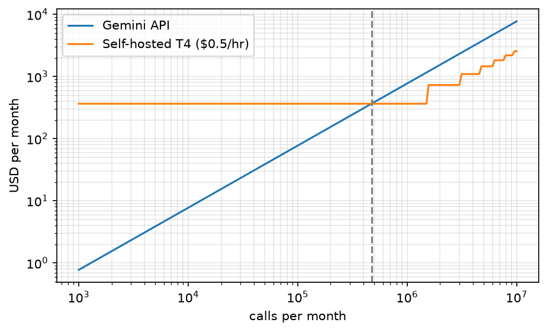

# Sovereign AI engine: summarizing US bills with a self-hosted open-weight model

Question: **should a team pay for a frontier API, or fine-tune and run a small open model on its own hardware?**
I answered it on BillSum (US congressional bills) with measured quality, latency, throughput and cost.

## Result
- Fine-tuning a 3B model (LoRA, 1,500 bills, one free T4 epoch) lifted ROUGE-2 from **0.237 to 0.342** and beat the Gemini 3.1 Flash-Lite API baseline (0.228).
- 4-bit quantization (Q4_K_M) cut the model from 5.8 GB to 1.8 GB and cost **0.007 ROUGE-1 / 0.009 ROUGE-L**, still above both baselines.
- Self-hosting beats the API on cost above about **472,705 calls/month** (assumes a $0.5/hr T4-class GPU running 24/7).

## Quality (200 BillSum test bills)
| System | ROUGE-1 | ROUGE-2 | ROUGE-L | BERTScore F1* |
|---|---|---|---|---|
| Base Qwen2.5-3B (Ollama, Mac) | 0.492 | 0.237 | 0.319 | 0.813 |
| Gemini 3.1 Flash-Lite (API) | 0.502 | 0.228 | 0.320 | 0.820 |
| Fine-tuned 16-bit (vLLM, T4) | 0.536 | 0.342 | 0.409 | 0.852 |
| Fine-tuned Q4_K_M GGUF (Ollama, Mac) | 0.529 | 0.328 | 0.400 | 0.846 |

*BERTScore used distilbert-base-uncased, so compare only within this table.

LLM judge (lenient rubric, flash-lite judge, 50 bills, scores 1-5):

| System | Faithfulness | Coverage |
|---|---|---|
| Base Qwen | 4.72 | 4.84 |
| Gemini Flash-Lite | 5.0 | 5.0 |
| Fine-tuned 16-bit | 4.32 | 3.64 |
| Fine-tuned Q4_K_M | 4.38 | 3.54 |

## Latency, throughput, cost (fine-tuned 16-bit on vLLM, Kaggle T4)
| Concurrency | P50 (s) | P95 (s) | Tokens/s | Requests/s |
|---|---|---|---|---|
| 1 | 7.78 | 12.51 | 24.6 | 0.13 |
| 8 | 15.69 | 26.54 | 104.1 | 0.49 |
| 32 | 53.06 | 86.47 | 125.5 | 0.59 |

- Gemini API: avg 1802 input + 214 output tokens per call = **$0.772 per 1,000 calls** ($0.25 / $1.50 per 1M tokens, standard rate).
- Self-hosted T4 at full load: **$0.283** (concurrency 8) to **$0.235** (concurrency 32) per 1,000 calls, but the GPU costs $365/month whether used or not.
- Crossover: ~472,705 calls/month (~15,757/day). See `results/crossover.png`.



## Why fine-tune at all
The base 3B model followed the task loosely (ROUGE-2 0.237). Training on 1,500 expert summaries taught the legislative summary style and length, adding 0.105 ROUGE-2.

## What quantization cost
| Format | Size | ROUGE-1 | ROUGE-L |
|---|---|---|---|
| fp16 | 5.8 GB | 0.536 | 0.409 |
| Q8_0 | 3.1 GB | not evaluated | not evaluated |
| Q4_K_M | 1.8 GB | 0.529 | 0.400 |

## Stack
Unsloth + PEFT (LoRA), vLLM (T4 serving), llama.cpp (GGUF), Ollama, FastAPI, Docker, Arize Phoenix tracing.

## Run it
```bash
pip install -r requirements.txt
python scripts/prepare_data.py          # BillSum subsets
python src/run_ollama.py 200 MODEL      # local model baseline
python src/run_gemini.py 200            # API baseline (GEMINI_API_KEY in .env)
python src/score.py results/*.jsonl
python src/cost.py 0.50                 # cost + crossover (arg = GPU $/hr)
docker build -t sovereign-ai-api api && docker run -p 8080:8080 --env-file .env sovereign-ai-api
```

## Limitations (read before trusting the numbers)
- One run per system on 200 bills, no confidence intervals or seeds comparison.
- ROUGE/BERTScore reward matching the reference style; the LLM judge is also noisy and Gemini graded a system that includes itself.
- Latencies are not comparable across systems: Q4 ran on a MacBook M4 via Ollama, 16-bit on a Kaggle T4 via vLLM with `--enforce-eager`, Gemini over the network. Use the vLLM table for serving claims.
- The GPU price ($0.5/hr) is an assumption; the API price is the list rate at time of writing and excludes batch discounts.
- Q8_0 was built but not evaluated. PubMedQA was not run.
